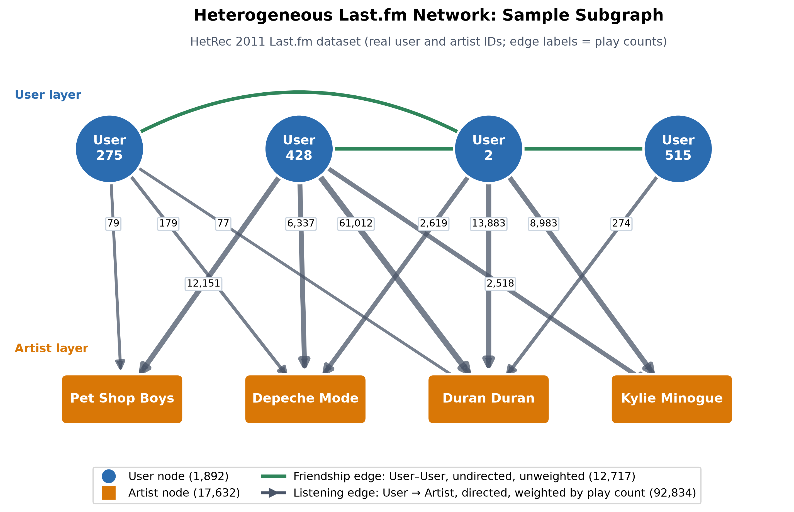

# Friendship and Musical Taste on Last.fm

Do friends listen to more of the same artists? This social network analysis follows 1,892 Last.fm users from a single listening record to a network of 19,524 users and artists. Across all user pairs, friends have **4.34 times the mean artist-profile overlap** of pairs with no recorded friendship. The notebook shows how to reproduce that comparison and use friends’ listening profiles to suggest music to a user whose listening history is hidden.

## Read the analysis

Open [the analysis notebook](lastfm_network_analysis.ipynb) to follow the calculations and figures, or [the project proposal](proposal.md) for the research questions and planned evaluation. A listening edge points from a user to an artist and carries a play count. For example, user 2 listened to Duran Duran 13,883 times. A friendship is a separate, undirected edge. Two users can share an artist without having a recorded friendship.

The eight figures progress from one listening edge to a small graph of four users and four artists, a user’s immediate circle of friends, and the artists shared by two friends. The remaining figures trace one artist’s listeners across friendship communities, aggregate friendships between communities, and draw the complete friendship and combined networks. Running the notebook also produces a browser-based explorer for inspecting individual users and their neighbors by ID.



*Figure 1. A subgraph of four listeners and four artists. Undirected lines denote friendship. Arrows point from users to artists and carry observed play counts.*

## Results

For each pair of users, the notebook divides the number of artists they share by the number of distinct artists in their combined profiles. This Jaccard score counts each artist once per user, regardless of play count. For example, users 2 and 428 each have 50 artists in their profiles. Nine artists appear in both lists, giving a score of 9/91, or 0.0989.

| Pair type | User pairs | Mean Jaccard | Median Jaccard |
| --- | ---: | ---: | ---: |
| Recorded friends | 12,717 | 0.1026 | 0.0870 |
| No recorded friendship | 1,776,169 | 0.0236 | 0.0101 |

The friendship layer has 20 connected components. The largest contains 1,843 users. As a music-discovery example, the notebook ranks artists by the number of user 2’s friends who listened to them. Nine of the user’s 13 friends listened to Depeche Mode, putting the band first in this ranking.

## Data

The Information Retrieval Group at Universidad Autónoma de Madrid prepared the **HetRec 2011 Last.fm 2K** dataset. GroupLens hosts the release. The authors make it available for non-commercial use and ask users to cite Last.fm. [GroupLens dataset page](https://grouplens.org/datasets/hetrec-2011/) · [Original dataset README](https://files.grouplens.org/datasets/hetrec2011/hetrec2011-lastfm-readme.txt)

The notebook reads the following six tab-separated files directly from `data/` beside the notebook. Download the six tables separately and extract them directly into this directory from the [official Last.fm archive](https://files.grouplens.org/datasets/hetrec2011/hetrec2011-lastfm-2k.zip).

| File | Contents |
| --- | --- |
| `artists.dat` | Catalog of 17,632 artists |
| `user_artists.dat` | 92,834 distinct user–artist pairs and their play counts |
| `user_friends.dat` | 25,434 rows encoding 12,717 reciprocal friendships |
| `tags.dat` | Dictionary of 11,946 tag IDs and their text |
| `user_taggedartists.dat` | 186,479 user–artist–tag assignments with calendar dates |
| `user_taggedartists-timestamps.dat` | The same assignments with timestamps in milliseconds |

The notebook checks that every friendship has its reverse row before counting it once. User and artist IDs occupy separate namespaces. Artist tags supply TF-IDF features. The preprocessing keeps all valid listening records, including those for the 5,499 catalog artists without tags.

## Run locally

Use Python 3.11 with Jupyter. From an Anaconda Prompt in the project directory, create an environment and register its kernel.

```shell
conda env create -n lastfm-sna -f environment.yml
conda activate lastfm-sna
python -m ipykernel install --user --name lastfm-sna --display-name "Python (lastfm-sna)"
```

In VS Code, open the project directory with the Jupyter extension installed, open the notebook, select **Python (lastfm-sna)** as the kernel, and run all cells in order. The notebook reads local data, exports [eight network figures](outputs/figures/) and writes a [standalone friendship explorer](outputs/friendship_explorer.html). Open the HTML file locally in a browser to use the search and zoom controls.

## Interpretation and next experiment

The dataset captures a historical sample. Each profile contains up to 50 artists, and 1,829 users reach that limit. Popular artists can increase the overlap between any two users. The observed difference is consistent with homophily, but listening and friendship timestamps would be needed to examine whether friendships preceded changes in listening. The available timestamps describe tag assignments.

The next experiment is to compare the observed overlap with a randomized listening network that preserves both the number of artists per user and the number of listeners per artist. The recommendation example also needs an evaluation across held-out users. The proposed comparison uses top-five recommendations from friends and a popularity baseline trained on the same remaining users, evaluated with Precision@5 and Recall@5.
